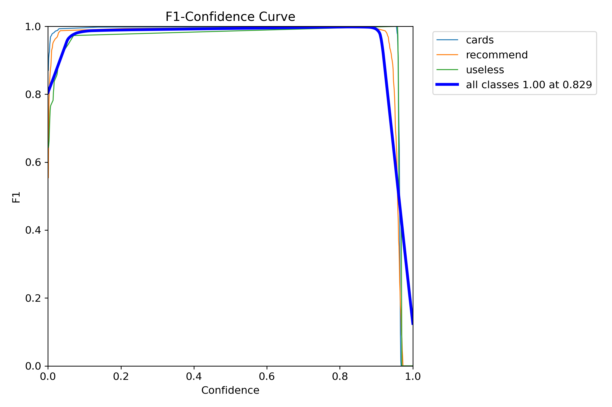
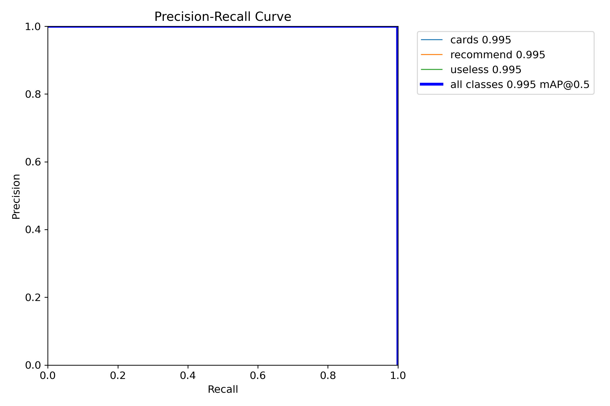
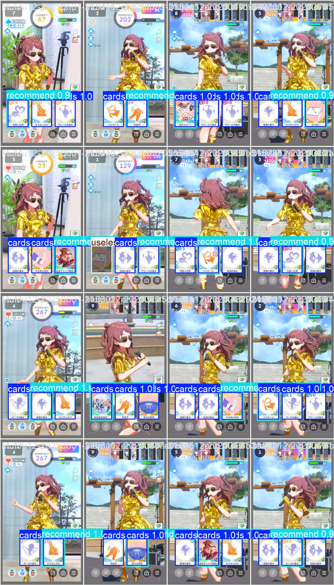

# MaaGakumasu 开发相关

MaaGakumasu 主要基于 [MaaFramework](https://github.com/MaaXYZ/MaaFramework) 框架开发。

选择 `JSON + 自定义逻辑扩展` 模式

请先阅读MFW官方文档，了解MFW的使用方法。

## 同步偶像卡

- `python tools/sync_cards.py` 从 GitHub 同步卡片和简中译名，更新卡库及两套培育配置。[日文数据](https://github.com/vertesan/gakumasu-diff) · [简中汉化](https://github.com/chinosk6/GakumasTranslationData)

## JSON 自动排版

VS Code 将 `.json` 作为 JSONC 打开，使用内置 JSON 格式化器，保存时按 2 空格自动排版。JSONC 已关闭自动缩进检测，避免文件原有缩进覆盖设置。命令行或代理修改文件后运行：

```powershell
npm ci
npm run format:json
npm run check:json
```

后两条命令默认处理相对 HEAD 修改及新增的 JSON/JSONC 文件。也可追加 `-- assets/tasks/produce.json` 指定文件。脚本使用 `jsonc-parser`，保留注释、字段顺序和原有换行符。

## Python 模块组织

培育运行时业务统一放在 `agent/produce/`，MaaFramework 动作入口在 `agent/custom/action/produce.py`，识别回调在 `agent/custom/reco/produce.py`。`agent/utils/` 仅保留通用日志和图像接口，项目维护脚本放在 `tools/`。

| 模块 | 职责 |
| --- | --- |
| `events.py` | 初/NIA 事件策略及共享事件基类 |
| `battle.py` | 出牌、饮料、候选记录、计时和超时兜底 |
| `options.py` | 工作、属性、试镜档位、饮料保留等选项 |
| `catalog.py` | 技能卡、饮料、P 道具身份查库与结构化参考数据 |
| `rewards.py` | 奖励候选布局、整页图标识别、详情名称 OCR |
| `selection.py` | 按本轮歌曲、已确认持有和候选库 ID 选择奖励 |
| `icons.py` | 上游本体图标的只读加载、偶像变体筛选与各页面匹配 |
| `capture.py` | 同步事件/截图写盘、内存识别与摘要输出 |
| `sessions.py` | 整轮会话、继续/跳过准备、中断收尾及框架 sinks |
| `state.py` | 战斗数值、Buff、姿态等可见状态识别 |
| `settlement.py` | 结算标签/图标定位、最终评价分数/评级与三维读取，初/NIA 公式校验；不依赖评级模板 |
| `analysis.py` | 无输入的内存 OCR、手牌与路线分析，提供脚本入口 |
| `reporting.py` / `audit.py` | 报告生成、会话收尾与证据审计 |
| `replay.py` / `replay.html` | 从审计时间线渲染离线回放，按需加载截图并处理缺图 |
| `console.py` | 出牌、奖励与结算的事件聚合、顺序、状态显示及库效果文案 |

新代码先放入已有职责模块，不按每个 helper、类型或常量新建文件。短小且只有一个调用方的逻辑通常并入调用方；真正独立的接口、生命周期或需要分别验证的逻辑再拆。约 100 行以下的辅助文件优先检查合并，约 700 行以上的模块优先检查职责，均不作为硬性行数要求。奖励采集和培育动作遵守相同标准，避免一边碎片化、一边不断堆叠大文件。

`agent/produce/analysis.py` 由客户端采集器启动，承担运行时同步识别及日志输出；正式技能卡、奖励库同步脚本生成客户端资源，放在 `tools/`。

内部使用包导入，客户端复用当前 MaaFramework Context 同步识别。`produce/__init__.py` 不自动注册动作或安装监听。运行链不依赖 Pillow。

整理文件时同步修改调用方、维护工具、源码指纹及文档，清除旧源码和旧字节码；保留原事件、数据库和历史报告。更详细的协作规则见根目录 `AGENTS.md` 的“模块组织与拆分规范”。

## 深度学习 YOLOv11 训练相关

当前 YOLOv11 主要用于 `自动培育` 的出牌识别。

模型训练参考 [MaaNeuralNetworkCookbook](https://github.com/MaaXYZ/MaaNeuralNetworkCookbook/tree/main/NeuralNetworkDetect) 官方文档。

数据集标注使用 [Roboflow](https://app.roboflow.com/gakumasu) 网站。

- `cards` 集用于识别*出牌*
- 早期用于上课、冲刺选项识别的 `button` 集已废弃，相关按钮识别已改为普通模板匹配

相关 `F1_curve.png` 和 `PR_curve.png` 如下




识别预览



> [!IMPORTANT]
> `cards` 集 目前902份样本，均已标注完成，对多卡重叠的情况进行了额外强化训练。
>
> 若您有兴趣参与标注或者提供样本，欢迎联系开发组。

### 出牌数据标注与验证

出牌模型使用互斥类别：普通可用牌标为 `cards`，推荐牌标为 `recommend`，不可用牌标为 `useless`。同一卡牌仅标一个类别；不同卡牌因遮挡产生的重叠框仍需保留。MaaFramework 会对不同类别的重叠框一起去重，因此不要在同一张推荐牌上同时标注 `cards` 和 `recommend`。

训练完成后，应通过实际使用的 MaaFramework 版本验证导出的 ONNX，确认最终检测结果，并覆盖无推荐牌、多牌遮挡、不可用牌、无手牌和动画过渡场景。训练指标不等同于实际出牌成功率。

出牌超时截图收集、候选导出和临时规则对比工具已移除。15 秒未识别到推荐牌时的兜底出牌逻辑继续保留；排查问题可保存 `debug/maa.log`，并使用模拟器截图工具收集原图，人工复核后在 Roboflow 标注。已有调试截图和训练素材不会自动删除。

截图样本建议使用 `MuMu模拟器12` 自带截图工具，出牌原图宽 720、高 1280（240DPI）；标注和验证时保持原始方向与尺寸。

### 出牌决策接口设计

以下接口用于后续出牌策略改造。当前出牌仍按游戏推荐、唯一可用牌和 15 秒超时兜底执行。完整模式的牌名识别目前用于日志、回放和持有牌记录。

1. `battle.card_candidates` 将一次 YOLO 结果转成当前画面的候选。候选沿用 `candidate_id`、`box`、`available`、`label` 和 `detector_confidence`。`candidate_id` 指向这次观察里的实体牌，同名牌各有自己的 ID 和点击框。
2. `analysis` 按候选框裁切标题，OCR 查库后把 `identity` 附回同一候选。名称或强化版本未确认时保留未知，候选仍可按游戏推荐或现有兜底参与选择。运行时复用当次 YOLO 候选。策略直接读取内存中的手牌，截图保存沿用独立开关。提前识别只在当前手牌仍能核对时复用。
   完整模式可调用 `DecisionCapture.read_battle(image, candidates, context=context)` 读取当前帧的 `cards`、`battle_state`（含 Buff）和 `drinks`。饮料先匹配圆框，再用瓶身彩色图标匹配 `pDrinks` 图库。每个可见瓶位单列一项，`slot` 从左到右为 1–4，`box` 使用原截图坐标，`identity` 包含库 ID、名称和库内效果。缺图或匹配不确定时保留瓶位，身份为 `null`。`drinks: []` 表示在已识别的战斗 HUD 中未检出瓶框，`null` 表示无法观察。预读交付时用当前帧更新瓶位；喝药或出牌后，应从下一个稳定画面重新读取。
3. 拟议的 `choose_play(hand, battle_state, elapsed_seconds)` 接收手牌、可读战斗状态和选择窗口耗时，返回动作、`candidate_id` 及原因。第一版按现有策略返回出牌、等待或跳过回合，后续再使用已确认的卡牌身份及效果评分。策略可直接用历史手牌离线验证。
4. `battle` 按本次观察中的 `candidate_id` 取原始 `box` 并执行点击。日志与回放复用该候选及选择理由。OCR 裁切可使用归一化坐标，点击始终使用控制器截图坐标。

### 培育记录与识别

`Produce.attach.fast_mode` 默认 `true`。快速模式在准备画面缓存、会话创建和采集器初始化前返回，只执行自动操作所需识别。两种语言的任务共用模式选项；偶像之路保持独立配置。

完整模式通过当前回调的 MaaFramework Context 同步识别和写盘。Context 每次显式传入，跨动作只保存图像与普通数据。Pipeline 负责输入、跳转、重试和等待；`sessions` 监听事件，复杂动作在所属模块记录决策。

会话格式为 schema 4，用户入口为 `report.html`，分段及识别结果在 `data/`。完整模式支持续跑；快速模式清除旧续接索引，之后重新开启记录时建立部分会话。待处理报告在本进程首次进入完整模式时恢复。

「开启截图记录」仅控制长期保存，关闭时直接识别内存图像。截图使用 MaaFramework 编解码并保留原尺寸。出牌和奖励将接近基准比例的截图归一化到 720×1280 识别，选牌框和点击使用原截图坐标。出牌日志计时从选择窗口开始到第二次点击完成，包含期间的识别与等待。

`DecisionCapture.record` 默认不保存图片；仅关键业务调用显式传入 `save_frame=True`。模板命中的奖励候选共用总览，OCR 补读记录详情截图和识别文本，领取时记录点击位置和框架执行结果。结算截图节点集中列在 `SETTLEMENT_SCREENSHOT_NODES`，`Click_1` 和跳过动画节点不保存截图。`frame_requested` 区分主动省略与截图遗失。

初流程的路线模板直接在原文件内裁为图标正文，裁剪区域为原模板的 `(30, 20, 75, 75)`（左、上、宽、高），沿用 `720×1280` 基准。SP 定位按该偏移还原按钮锚点。初/NIA 在路线动作前等待命中的选项模板框连续静止 500 毫秒，避开相邻按钮之间的偶像和背景动画，再识别整排选项与正常尺寸的 SP。

### 奖励与图库

`icons.py` 读取 `data/images/{skillCards,pDrinks,pItems}/*.png`，源码布局对应 `assets/data/images`。技能卡纳入所有流派及当前偶像变体；偶像未知时检索全库。更新成功后清除内存图库缓存，手工替换图片后需重启 Agent。下载与打包规则见 [培育资源更新](培育资源更新.md)。

匹配使用灰度特征初筛及 NumPy 归一化相关核验，阈值为 0.7，身份或版本分差至少 0.05。技能卡按中央插画识别牌名，再用边缘的费用、数值和加号核对普通或强化版本。置灰候选跳过。牌名已确认时可按适用版本中最低的规则档位参与选择，普通强化页按可强化的基础版本评价升级收益。只有具体版本核验后才按库 ID 更新持有。图像和特征驻留内存。

完整模式从一帧总览匹配奖励候选图标，未命中时点开详情并用 OCR 读名称、查库，再由规则选择并交给流水线领取。商店、强化、删除／复制／变换读取可见候选；移动页保留原选牌流程。换瓶页按列表位置区分同名实例。`selection.debug_choice` 随「开启截图记录」保存调试画面。

### 流派奖励选择

关闭「快速模式」后，先看本轮歌曲的推荐效果，再看已经识别到的持有卡、P 道具和体力。固有卡缺少发动费用时，优先补费用。奖励角标只在走默认选择时生效。

| 打法 | 先拿什么 | 饮料举例 |
| --- | --- | --- |
| 感性·好调 | 先让输出回合有好调，再拿绝好调。「魅惑的视线」需要 3 集中。 | 维生素饮料补好调。 |
| 感性·集中 | 先补集中，再拿「击掌」等集中转分牌。能稳定提供集中时，强化「击掌」更有价值。 | 冰咖啡补集中。 |
| 理性·干劲 | 先有干劲、元气，再拿「元气的问候」把元气变成分数。 | 缺干劲留热咖啡，缺元气留乌龙茶。 |
| 理性·好印象 | 先拿好印象来源，再补转分。手中核心消耗干劲时，优先补足费用。 | 路易波士茶补好印象，热咖啡补干劲。 |
| 非凡·强气／冰火 | 围绕强气和温存直接切换。已有强气时优先补温存，两边都有后再补切换收益。 | 姜汁汽水进强气，焙茶进温存。 |
| 非凡·全力 | 先充能。见过本轮进入全力后，再提高全力输出的优先级。 | 需要充能时看饮料附带的切色效果。 |
| 非凡·温存 | 先拿能进入温存的牌，再补充能和输出。 | 焙茶可直接进温存。 |

- **领取与复制**　选能补当前缺口的卡。已持有的 P 道具若能因获得这张卡触发，也计入选择。复制只考虑允许复制的卡。
- **强化**　在有强化收益且能使用的牌中，按 SSR（彩）、SR（黄）、R、N 的顺序选。同稀有度优先补当前流派或固有联动，仍相同则优先选已确认版本、位置靠前的牌。
- **删除**　先删「困意」等无效果障碍牌，再删同名多余副本，最后才考虑已有更好替代的基础得分牌。普通版与强化版并存时优先删普通版。商店按已确认的持牌张数估算，进入删除页后结合可见候选选牌。
- **变换**　优先处理无效果障碍牌，其次是已有同费或低费高分替代的基础得分牌。
- **换瓶**　新瓶和手持饮料一起比较，保留三瓶。同名饮料按行区分，同档优先保留已勾选的瓶子。候选读不全时沿用游戏勾选。
- **商店**　买卡增加一张牌，强化改善一张已持有的牌。两者共用 P 点，和饮料、删除一起按本轮规则排序，同档优先便宜的选项。普通强化和删除各限一次，费用按当次货架显示读取。进店时读取货架，成交后核对余额，用已买商品和剩余预算调整计划，完成后离店。

日志里的「自动」会给出命中理由。「默认」会标明推荐项、活动推荐项或第一项等实际依据。开启「快速模式」或所有候选都没命中规则时，按任务原有设置选择。

规则表由客户端随包发布，源码位于 `assets/data/produce_reward_rules.json`，安装包位于 `data/produce_reward_rules.json`。卡库更新后，通用规则直接读取新库的效果、费用及强化版本。维护歌曲或道具专项时，用当前偶像配置复核 `song_index`，逐条核对专项 ID、触发条件及普通／强化版本，再更新 `catalog_sha256` 的两项摘要。摘要不符时仅使用通用效果规则。

### 状态与结算

`state` 共享体力、三维与战斗 HUD 解析。首次仍按原 OCR 流程判断课程或考试布局；成功读取 HUD 后，在有明确开始与结束事件的同一场战斗内复用布局，换场或退出时失效。牌名、数值与 Buff 继续按原方式识别。真实观测保存在 `observations`，策略兜底值保存在 `policy_inputs_with_fallbacks`，未知与零值分开。

`settlement` 按文字标签或属性图标定位最终分数、评级和三维，分别校验初与 NIA 的公式。最终三维只汇总结束阶段的 `settlement_observation`。仅有画面评分时，回放和日志单独标注按评分推算的评级。NIA 终试单独记录本人名次、试镜得分与合格状态，重试清除前次排名。翻页采集沿用现有输入，结算等待限于明确的 Next、生成或完成按钮，结束循环保留无条件点击兜底。

Buff 仅在当前出牌画面只读识别，配置位于 `battle_buff_templates.json`。新增模板取自 MuMu 12 日文 NIA PRO 的 `720×1280` 竖屏原始截图，未缩放，并以同回合详情中的名称及效果核对；截图来源和离线验证材料保留在 Lab 的 `debug/`。追加使用计数独立保存为 `additionalCardUses`，不推断当前总出牌次数。临时详情输入流程已移除，已有截图、事件与报告保留；未显示的状态不补零。
