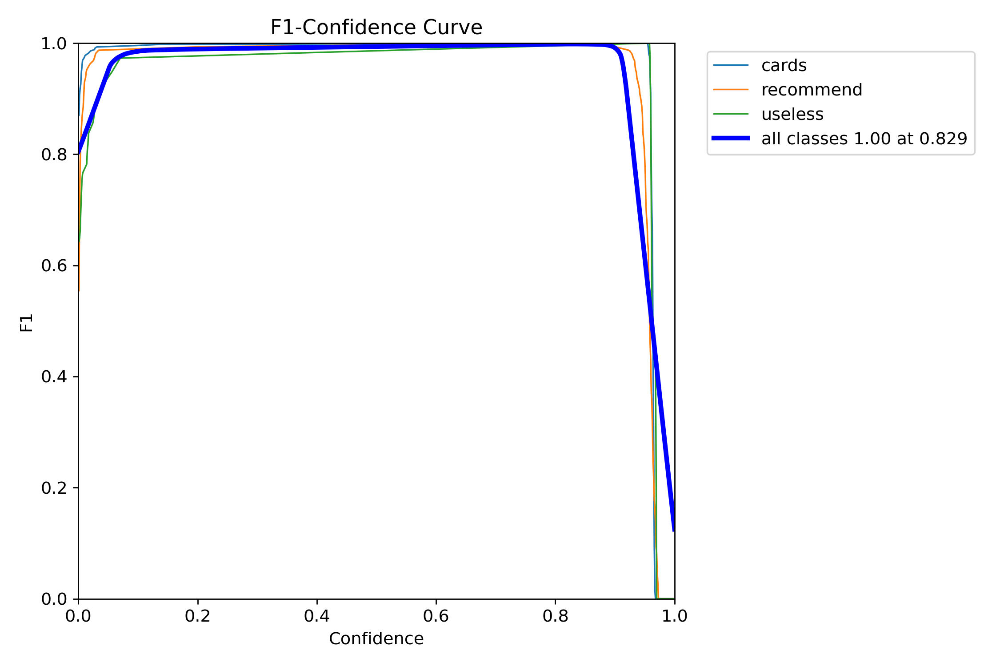
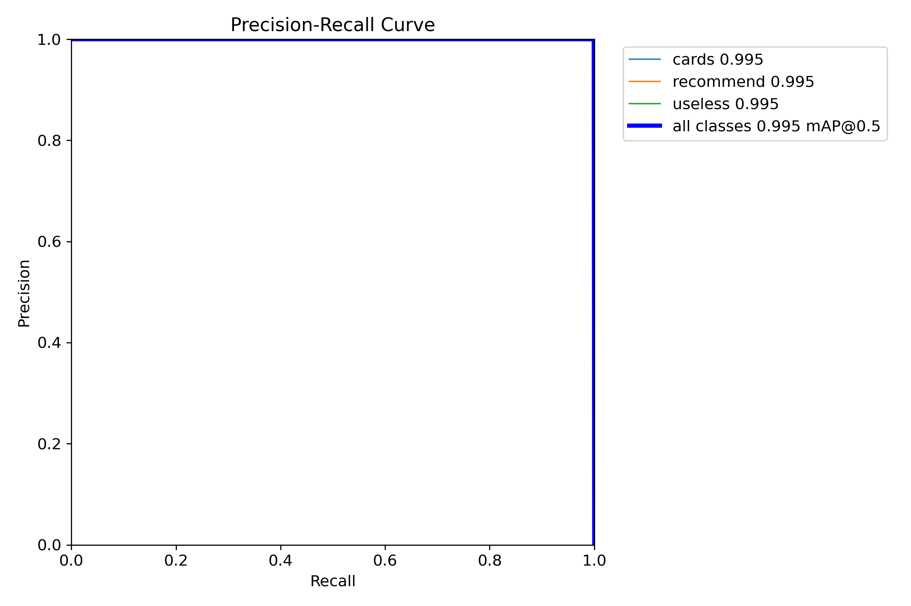

# MaaGakumasu 开发相关

MaaGakumasu 主要基于 [MaaFramework](https://github.com/MaaXYZ/MaaFramework) 框架开发。

选择 `JSON + 自定义逻辑扩展` 模式

请先阅读MFW官方文档，了解MFW的使用方法。

## Python 模块组织

培育运行时业务统一放在 `agent/produce/`，MaaFramework 动作入口在 `agent/custom/action/produce.py`，识别回调在 `agent/custom/reco/produce.py`。`agent/utils/` 仅保留通用日志和图像接口，项目维护脚本放在 `tools/`，培育训练、实验与回归代码集中在 `research/produce/`。

| 模块 | 职责 |
| --- | --- |
| `events.py` | 初/NIA 事件策略及共享事件基类 |
| `battle.py` | 出牌、饮料、候选记录、计时和超时兜底 |
| `options.py` | 工作、属性、试镜档位、饮料保留等选项 |
| `catalog.py` | 技能卡、饮料、P 道具身份查库与结构化参考数据 |
| `rewards.py` | 奖励候选布局、预览/恢复、详情缓存、名称读取 |
| `icon_cache.py` | 从奖励与已选卡牌确认页学习的共享本体图标缓存、分类存储和各页面只读匹配 |
| `capture.py` | 同步事件/截图写盘、内存识别与摘要输出 |
| `sessions.py` | 整轮会话、继续/跳过准备、中断收尾及框架 sinks |
| `state.py` | 战斗数值、Buff、姿态等可见状态识别 |
| `settlement.py` | 结算标签/图标定位、最终评价分数/评级与三维读取，初/NIA 公式校验；不依赖评级模板 |
| `analysis.py` | 无输入的内存 OCR、手牌与路线分析，提供脚本入口 |
| `reporting.py` / `audit.py` | 单轮回放、自动收尾与证据审计；离线 CLI 复用同一实现 |
| `console.py` | 出牌、奖励与结算的事件聚合、顺序、状态显示及库效果文案 |

新代码先放入已有职责模块，不按每个 helper、类型或常量新建文件。短小且只有一个调用方的逻辑通常并入调用方；真正独立的接口、生命周期或需要分别验证的逻辑再拆。约 100 行以下的辅助文件优先检查合并，约 700 行以上的模块优先检查职责，均不作为硬性行数要求。奖励采集和培育动作遵守相同标准，避免一边碎片化、一边不断堆叠大文件。

培育实验代码放在 `research/produce/`：`capture_battle.py` 是独立采样入口，`report_produce_session.py` / `report_decision_capture.py` 加载证据并生成报告，`produce_reporting.py` 负责跨轮统计；单轮生成与审计复用运行时 `produce.reporting` / `produce.audit`，`analyze_choices.py` 从已验收报告生成事件/奖励选择频率与数据准备度，`build_buff_templates.py` 从实验样本取模板，`test_reporting.py` 使用合成数据做离线回归。具体入口和目录边界见 [research 说明](../../research/README.md)。实验输出、合成素材和一次性脚本统一保存在 `../MaaGakumasuLab/debug/`；客户端正常运行的原始记录留在对应客户端。

`agent/produce/analysis.py` 由客户端采集器启动，承担运行时同步识别及日志输出，因此继续放在 Agent 内；正式技能卡、奖励库同步脚本生成客户端资源，继续放在 `tools/`。客户端不依赖 `research/`，现有发布包不包含该目录。

内部使用包导入；客户端复用当前 MaaFramework Context 同步识别，离线 CLI 入口设置一次 `agent/` 路径。`produce/__init__.py` 不自动注册动作或安装监听。运行链不依赖 Pillow。

整理文件时同步修改调用方、维护工具、源码指纹及文档，清除旧源码和旧字节码；保留原事件、数据库和历史报告。更详细的协作规则见根目录 `AGENTS.md` 的“模块组织与拆分规范”。

## 深度学习 YOLOv11 训练相关

当前 YOLOv11 主要用于 `自动培育` 的出牌识别。

模型训练参考 [MaaNeuralNetworkCookbook](https://github.com/MaaXYZ/MaaNeuralNetworkCookbook/tree/main/NeuralNetworkDetect) 官方文档。

数据集标注使用 [Roboflow](https://app.roboflow.com/gakumasu) 网站。

- `cards` 集用于识别*出牌*
- 早期用于上课、冲刺选项识别的 `button` 集已废弃，相关按钮识别已改为普通模板匹配

相关 `F1_curve.png` 和 `PR_curve.png` 如下

识别预览

> [!IMPORTANT]
> `cards` 集 目前902份样本，均已标注完成，对多卡重叠的情况进行了额外强化训练。
>
> 若您有兴趣参与标注或者提供样本，欢迎联系开发组。

### 出牌数据标注与验证

出牌模型使用互斥类别：普通可用牌标为 `cards`，推荐牌标为 `recommend`，不可用牌标为 `useless`。同一卡牌仅标一个类别；不同卡牌因遮挡产生的重叠框仍需保留。MaaFramework 会对不同类别的重叠框一起去重，因此不要在同一张推荐牌上同时标注 `cards` 和 `recommend`。

训练完成后，应通过实际使用的 MaaFramework 版本验证导出的 ONNX，确认最终检测结果，并覆盖无推荐牌、多牌遮挡、不可用牌、无手牌和动画过渡场景。训练指标不等同于实际出牌成功率。

出牌超时截图收集、候选导出和临时规则对比工具已移除。15 秒未识别到推荐牌时的兜底出牌逻辑继续保留；排查问题可保存 `debug/maa.log`，并使用模拟器截图工具收集原图，人工复核后在 Roboflow 标注。已有调试截图和训练素材不会自动删除。

截图样本建议使用 `MuMu模拟器12` 自带截图工具，出牌原图宽 720、高 1280（240DPI）；标注和验证时保持原始方向与尺寸。

### 对局信息采集与技能卡匹配

开发中的对局采集模块只保存每次出牌前画面，记录手牌检测与实际操作；下一次操作前观测复用于上次操作结果，并在当前框架回调内同步用 MaaFramework OCR 匹配固定版本的技能卡库、读取剩余回合和可见战斗数值。截图保留 MaaFramework 返回尺寸，识别按 720×1280 基准处理；手牌支持前缀匹配，Buff 使用框架原生绿幕模板匹配与 OCR，包含好调/绝好调回合数与集中效果提升百分比，另行读取非凡强气/温存姿态、阶段、全力值和指针预告。同位置 Buff/姿态候选会比较证据；明确登记的集中图标亲缘候选可用整数/百分比区分，单位冲突或模板歧义保留未知。培育会话关联中断分段、路线候选、选择输入和结算观察，报告汇总跨分段结果。完整开局牌组、实际扣费/库存变化及更多布局仍需独立证据。识别不确定的牌名、强化、隐藏状态与改造保留未知。控制台将同一操作前后的状态、手牌、变化和耗时合为一条默认折叠日志，按逻辑操作连续编号；原始事件编号仍保留。卡库参考效果不等于当下实际收益。启用方式、覆盖限制与离线重读见 [出牌数据采集](出牌数据采集.md)，采样方法见 [出牌状态采样计划](出牌状态采样计划.md)；具体轮次、截图来源和验证报告保存在 `debug/`。

### 培育记录接口与 Pipeline 边界

Pipeline 继续负责识别、输入、跳转、重试和等待，原生 `focus` 负责普通阶段提示及通知、手动接管弹窗。Agent 的事件监听只观察已有执行；复杂动作在原模块中记录候选、判断依据及执行结果，不为记录新增 Custom 节点。

`state` 共享体力、三维解析，保留页面 ROI；`observations` 的真实值和未知与 `policy_inputs_with_fallbacks` 的旧策略输入分开。原策略版本与配置随会话保存，未知字段不转换成观测到的零值。

新会话目录为 `YYYYMMDD_HHmm_难度_偶像_歌曲`，仅重名时加数字序号。用户入口只有 `report.html`；清单、识别结果与分段放入 `data/`，续跑分段为 `data/01/`、`data/02/`，`relative_path` 相对于本局目录。仅支持 schema 4。`data/report_pending.json` 持久化收尾请求，同步生成回放并提示链接，启动时补处理已关闭会话。不保存识别临时全图。

奖励缓存位于 `debug/cache/`，由 `icon_cache.py` 管理，以卡库、布局和语言相关配置校验有效性。`skill_card/`、`drink/`、`p_item/` 分目录保存。接受已核验详情的 `reward_candidate_preview`，以及 `ProduceChooseStrengthen` / `ProduceChooseDeleteClick` 确认按钮前的 `route_before` 学习。后者必须核验页面标题、左上详情区域唯一卡名、卡库精确匹配和至少 0.95 的 OCR 置信度，只裁取上方已选对象图标，不学习列表或强化后预览；缺失、歧义、改造和未知布局均跳过。识别记录中的 `selected_icon_cache_write` 保存写入结果，模板记录 `source_kind` 及来源事件；技能卡按去除尾部强化加号的名称合并，保留 128×128 图标，饮料和 P 道具只用纯绿色屏蔽四周 5 像素外框；技能卡额外屏蔽四角数字、右侧加号和底部标记，通过框架 `green_mask=True` 仅匹配未遮罩区域。缓存命中不确认强化、改造、实际效果或持有情况，也不为核验版本增加预览点击。旧格式不直接沿用，重新从核验页面学习，旧图标文件保留。

页面观察使用 MaaFramework `ImageBuffer.resize` 适配尺度，再通过 `TemplateMatch` 在候选 ROI 检索，只处理已有 `route_before` 和移动页面内存画面，不新增输入或翻页。先用 `method=1` 的归一化平方差筛选（差异不超过 0.08，越小越接近），排除明显变暗或外观不一致项；再对命中裁片用 `method=5` 核验本体（至少 0.80），同位置其他身份在 0.05 分差内拒绝确认。框架 `all_results` 需显式检查分数方向和阈值。119/120 像素图标统一按 120 检索；相同页面 ROI、操作类型与缓存版本复用最近一次结果，图像或缓存变化后重新识别。外观通过不代表可选状态已核验。日志以单行 HTML details 列出命中名称，不包含图片或图片链接。`write.lock` 用于跨客户端进程的系统文件锁，仍有作用，不应在运行中删除。

### 当前记录接口约束

报告按卡牌调整页面标题及确认按钮的 OCR 区分删除、复制、变换；识别冲突或缺失时保留类型未知，不从多模板结果数组的下标推断类型。选牌位置点击和确认按钮点击分别展示，强化确认页可列出对象与强化后预览；预览不代表操作成功。此层只复用已有记录，不修改 Pipeline 选牌策略，也不增加设备输入。

识别使用每次记录显式传入的有效 Context，不能把嵌套 sink 的短生命周期句柄存到会话供后续动作使用。客户端不创建培育写盘线程、OCR 子进程、消息转发线程或报告轮询线程。同步识别、写盘和日志有真实开销；出牌标题计时从选择窗口开始到第二次点击完成，含操作前识别，不含后续动画等待，不能当作纯点击或纯 OCR 用时。

`custom/action/produce.py` 负责框架注册与奖励输入适配，`custom/reco/produce.py` 负责识别回调，`produce/` 承载业务与记录。入口仍有少量业务实现，后续只在调用边界有明确收益时继续收拢，不为目录整齐增加转发层。
