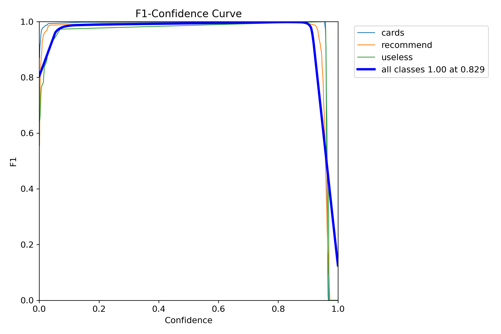
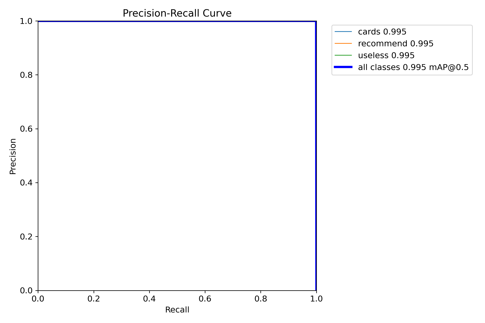

# MaaGakumasu 开发相关

MaaGakumasu 主要基于 [MaaFramework](https://github.com/MaaXYZ/MaaFramework) 框架开发。

选择 `JSON + 自定义逻辑扩展` 模式

请先阅读MFW官方文档，了解MFW的使用方法。

## JSON 自动排版

VS Code 将 `.json` 作为 JSONC 打开，使用内置 JSON 格式化器，保存时按 2 空格自动排版。JSONC 已关闭自动缩进检测，避免文件原有缩进覆盖设置。命令行或代理修改文件后运行：

```powershell
npm ci
npm run format:json
npm run check:json
```

后两条命令默认处理相对 HEAD 修改及新增的 JSON/JSONC 文件。也可追加 `-- assets/tasks/produce.json` 指定文件。脚本使用 `jsonc-parser`，保留注释、字段顺序和原有换行符。

## Python 模块组织

培育运行时业务统一放在 `agent/produce/`，MaaFramework 动作入口在 `agent/custom/action/produce.py`，识别回调在 `agent/custom/reco/produce.py`。`agent/utils/` 仅保留通用日志和图像接口，项目维护脚本放在 `tools/`，培育训练、实验与回归代码集中在 `research/produce/`。

| 模块 | 职责 |
| --- | --- |
| `events.py` | 初/NIA 事件策略及共享事件基类 |
| `battle.py` | 出牌、饮料、候选记录、计时和超时兜底 |
| `options.py` | 工作、属性、试镜档位、饮料保留等选项 |
| `catalog.py` | 技能卡、饮料、P 道具身份查库与结构化参考数据 |
| `rewards.py` | 奖励候选布局、预览/恢复、详情缓存、名称读取 |
| `icons.py` | 上游本体图标的只读加载、偶像变体筛选与各页面匹配 |
| `capture.py` | 同步事件/截图写盘、内存识别与摘要输出 |
| `sessions.py` | 整轮会话、继续/跳过准备、中断收尾及框架 sinks |
| `state.py` | 战斗数值、Buff、姿态等可见状态识别 |
| `settlement.py` | 结算标签/图标定位、最终评价分数/评级与三维读取，初/NIA 公式校验；不依赖评级模板 |
| `analysis.py` | 无输入的内存 OCR、手牌与路线分析，提供脚本入口 |
| `reporting.py` / `audit.py` | 单轮回放、自动收尾与证据审计；离线 CLI 复用同一实现 |
| `console.py` | 出牌、奖励与结算的事件聚合、顺序、状态显示及库效果文案 |

新代码先放入已有职责模块，不按每个 helper、类型或常量新建文件。短小且只有一个调用方的逻辑通常并入调用方；真正独立的接口、生命周期或需要分别验证的逻辑再拆。约 100 行以下的辅助文件优先检查合并，约 700 行以上的模块优先检查职责，均不作为硬性行数要求。奖励采集和培育动作遵守相同标准，避免一边碎片化、一边不断堆叠大文件。

培育实验代码放在 `research/produce/`：`capture_battle.py` 是独立采样入口，`report_produce_session.py` / `report_decision_capture.py` 加载证据并生成报告，`produce_reporting.py` 负责跨轮统计；单轮生成与审计复用运行时 `produce.reporting` / `produce.audit`，`analyze_choices.py` 从已验收报告生成事件/奖励选择频率与数据准备度，`build_buff_templates.py` 从实验样本取模板。具体入口和目录边界见 [research 说明](../../research/README.md)。实验输出、合成素材和一次性脚本统一保存在 `../MaaGakumasuLab/debug/`；客户端正常运行的原始记录留在对应客户端。

`agent/produce/analysis.py` 由客户端采集器启动，承担运行时同步识别及日志输出，因此继续放在 Agent 内；正式技能卡、奖励库同步脚本生成客户端资源，继续放在 `tools/`。客户端不依赖 `research/`，现有发布包不包含该目录。

内部使用包导入；客户端复用当前 MaaFramework Context 同步识别，离线 CLI 入口设置一次 `agent/` 路径。`produce/__init__.py` 不自动注册动作或安装监听。运行链不依赖 Pillow。

整理文件时同步修改调用方、维护工具、源码指纹及文档，清除旧源码和旧字节码；保留原事件、数据库和历史报告。更详细的协作规则见根目录 `AGENTS.md` 的“模块组织与拆分规范”。

## 深度学习 YOLOv11 训练相关

当前 YOLOv11 主要用于 `自动培育` 的出牌识别。

模型训练参考 [MaaNeuralNetworkCookbook](https://github.com/MaaXYZ/MaaNeuralNetworkCookbook/tree/main/NeuralNetworkDetect) 官方文档。

数据集标注使用 [Roboflow](https://app.roboflow.com/gakumasu) 网站。

- `cards` 集用于识别*出牌*
- 早期用于上课、冲刺选项识别的 `button` 集已废弃，相关按钮识别已改为普通模板匹配

相关 `F1_curve.png` 和 `PR_curve.png` 如下




识别预览


> [!IMPORTANT]
> `cards` 集 目前902份样本，均已标注完成，对多卡重叠的情况进行了额外强化训练。
>
> 若您有兴趣参与标注或者提供样本，欢迎联系开发组。

### 出牌数据标注与验证

出牌模型使用互斥类别：普通可用牌标为 `cards`，推荐牌标为 `recommend`，不可用牌标为 `useless`。同一卡牌仅标一个类别；不同卡牌因遮挡产生的重叠框仍需保留。MaaFramework 会对不同类别的重叠框一起去重，因此不要在同一张推荐牌上同时标注 `cards` 和 `recommend`。

训练完成后，应通过实际使用的 MaaFramework 版本验证导出的 ONNX，确认最终检测结果，并覆盖无推荐牌、多牌遮挡、不可用牌、无手牌和动画过渡场景。训练指标不等同于实际出牌成功率。

出牌超时截图收集、候选导出和临时规则对比工具已移除。15 秒未识别到推荐牌时的兜底出牌逻辑继续保留；排查问题可保存 `debug/maa.log`，并使用模拟器截图工具收集原图，人工复核后在 Roboflow 标注。已有调试截图和训练素材不会自动删除。

截图样本建议使用 `MuMu模拟器12` 自带截图工具，出牌原图宽 720、高 1280（240DPI）；标注和验证时保持原始方向与尺寸。

### 培育记录与识别

`Produce.attach.fast_mode` 默认 `true`。快速模式在准备画面缓存、会话创建和采集器初始化前返回，只执行自动操作所需识别。两种语言的任务共用模式选项；偶像之路保持独立配置。

完整模式通过当前回调的 MaaFramework Context 同步识别和写盘。Context 每次显式传入，跨动作只保存图像与普通数据。Pipeline 负责输入、跳转、重试和等待；`sessions` 监听事件，复杂动作在所属模块记录决策。

会话格式为 schema 4，用户入口为 `report.html`，分段及识别结果在 `data/`。完整模式支持续跑；快速模式清除旧续接索引，之后重新开启记录时建立部分会话。待处理报告在本进程首次进入完整模式时恢复。目录结构和离线命令见 [出牌数据采集](出牌数据采集.md)。

「开启截图记录」仅控制长期保存，关闭时直接识别内存图像。截图使用 MaaFramework 编解码并保留原尺寸，识别坐标以 720×1280 为基准。出牌日志计时从选择窗口开始到第二次点击完成，包含期间的识别与等待。

`DecisionCapture.record` 默认不保存图片；仅关键业务调用显式传入 `save_frame=True`。奖励总览保留一张图，图标命中的候选通过 `frame_reference` 共用总览，详情预览另存；领取核验和路线后续观察只记录文字及内存识别。结算截图节点集中列在 `SETTLEMENT_SCREENSHOT_NODES`，`Click_1` 和跳过动画节点不保存截图。`frame_requested` 区分主动省略与截图遗失，原有输入及冻结等待保持不变。

初流程的路线模板直接在原文件内裁为图标正文，裁剪区域为原模板的 `(30, 20, 75, 75)`（左、上、宽、高），沿用 `720×1280` 基准；SP 定位按该偏移还原按钮锚点。初/NIA 均在路线动作前等待选项区域 `[0, 880, 720, 240]` 连续静止 500 毫秒，再识别课程与正常尺寸的 SP，不进行缩放匹配。

报告按每次进店汇总操作，展示 `shop_entry_observation` 保存的稳定入口截图，购买、确认和重复退出的逐条记录收在“操作明细”中。

### 奖励与图库

`icons.py` 读取 `data/images/{skillCards,pDrinks,pItems}/*.png`，源码布局对应 `assets/data/images`。技能卡纳入所有流派及当前偶像变体；偶像未知时检索全库。更新成功后清除内存图库缓存，手工替换图片后需重启 Agent。下载与打包规则见 [培育资源更新](培育资源更新.md)。

匹配使用灰度特征初筛及 NumPy 归一化相关核验，阈值为 0.7，身份或版本分差至少 0.05。普通与强化版本独立确认，费用、数值和加号参与版本核验；置灰候选跳过。图像和特征驻留内存。

完整模式先识别奖励候选，必要时预览详情并 OCR 名称，再由流水线按配置选择，领取前核验页面及实际选中项。商店、强化、删除／复制／变换和移动页面只匹配可见图标。身份或版本不明时保留未知；卡库效果作为静态参考展示。

### 状态与结算

`state` 共享体力、三维与战斗 HUD 解析。真实观测保存在 `observations`，策略兜底值保存在 `policy_inputs_with_fallbacks`，未知与零值分开。

`settlement` 按文字标签或属性图标定位最终分数、评级和三维，分别校验初与 NIA 的公式。最终三维只汇总结束阶段的 `settlement_observation`。翻页采集沿用现有输入，结算等待限于明确的 Next、生成或完成按钮，结束循环保留无条件点击兜底。

模块职责见上表，研究入口见 [research 说明](../../research/README.md)。本地测试不纳入版本控制，实验记录存入 `../MaaGakumasuLab/debug/`。
